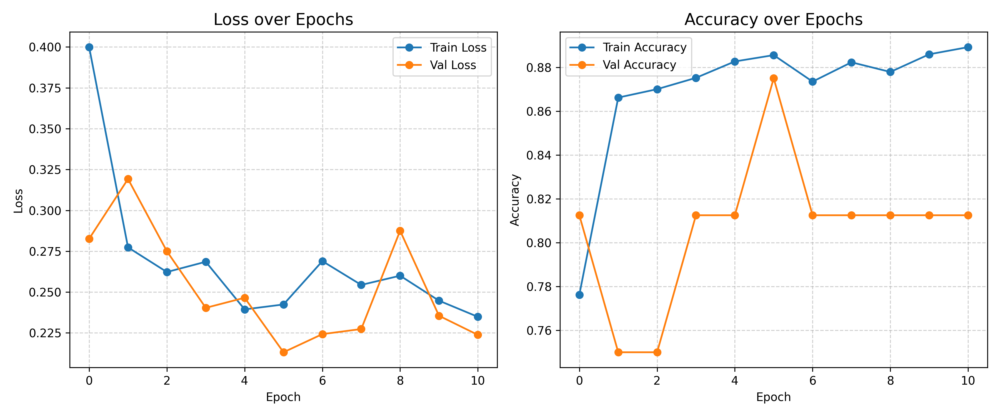
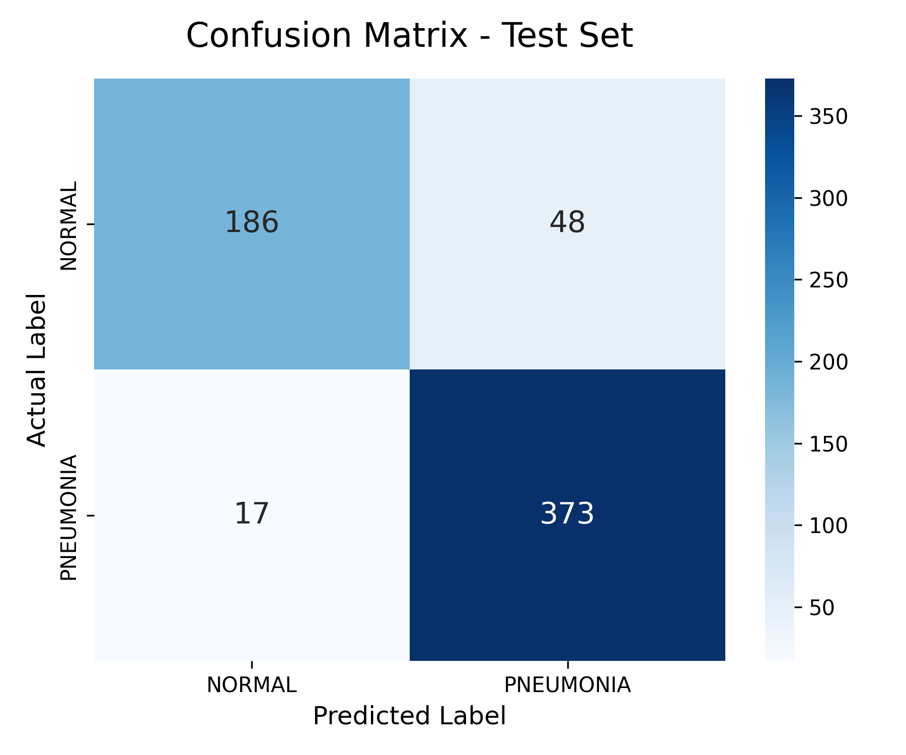
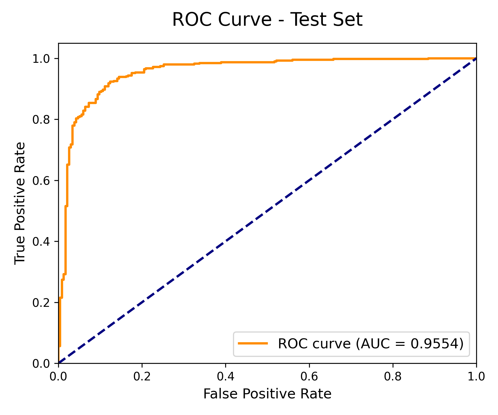
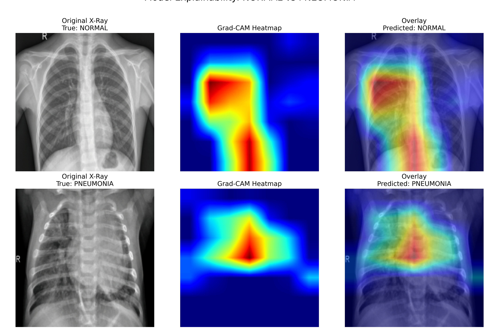

# 🩺 Chest X-Ray Pneumonia Classification

A Deep Learning project using PyTorch and Transfer Learning (ResNet18) to classify Chest X-Rays into **NORMAL** and **PNEUMONIA**.

## 📊 Dataset
The dataset is sourced from [Kaggle: Chest X-Ray Images (Pneumonia)](https://www.kaggle.com/datasets/paultimothymooney/chest-xray-pneumonia).
- **Train:** 5,216 images
- **Validation:** 16 images
- **Test:** 624 images

## 📈 Results
The model achieved the following results on the unseen test set:
- **Test Accuracy:** 90.06%
- **ROC-AUC Score:** 0.9556
- **Pneumonia Recall:** 94% (Crucial for medical diagnosis)

### Training History


### Confusion Matrix & ROC Curve
<p float="left">
  
  
</p>

### Model Explainability (Grad-CAM)
*Notice how the model correctly focuses on the lung opacities for the Pneumonia case, rather than irrelevant artifacts.*


## 🛠️ Installation & Usage
1. Clone the repository:
   ```bash
   git clone https://github.com/hilaliqbal18/Chest-XRay-Pneumonia-Classification.git
   cd Chest-XRay-Pneumonia-Classification